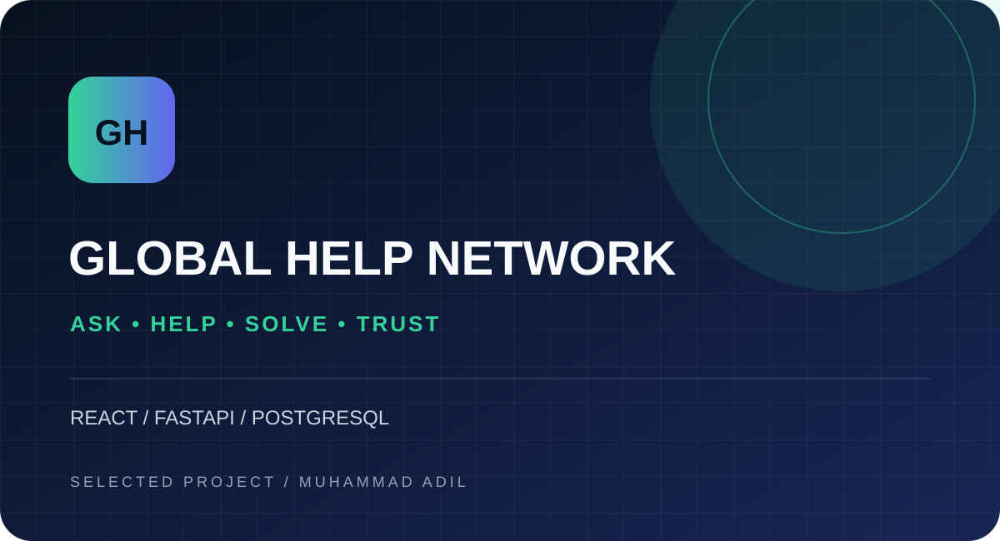
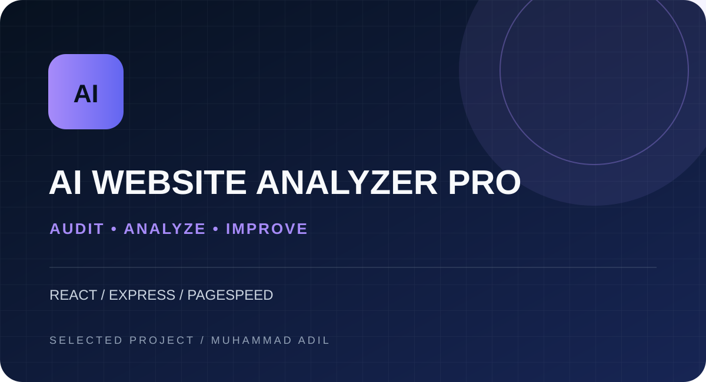
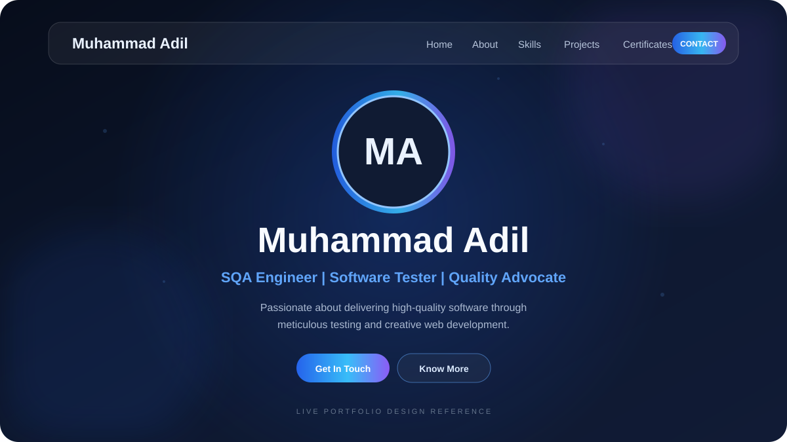
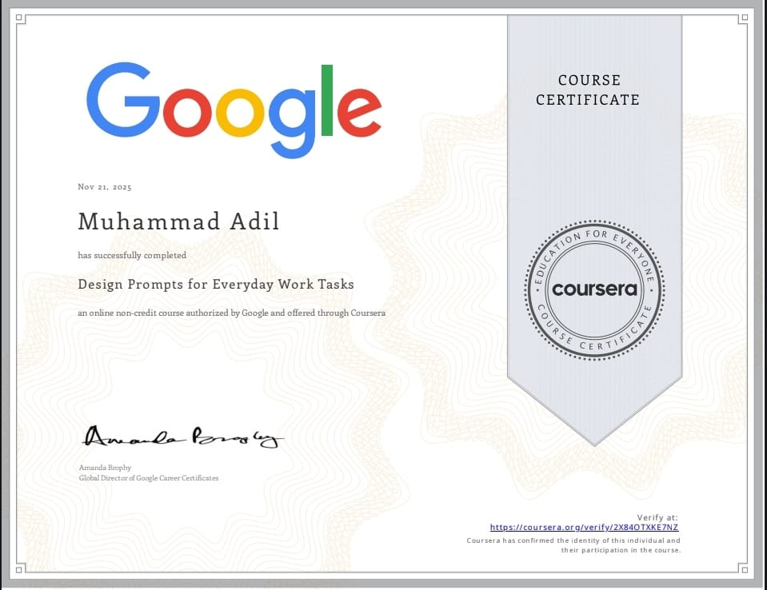
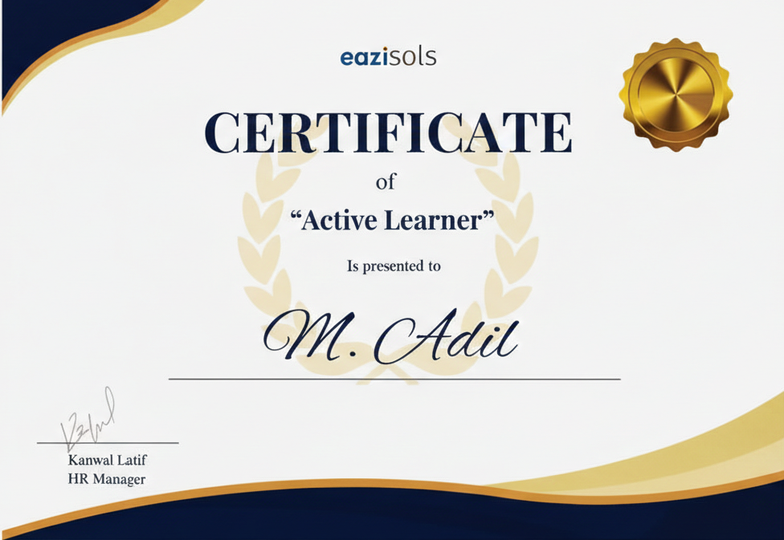
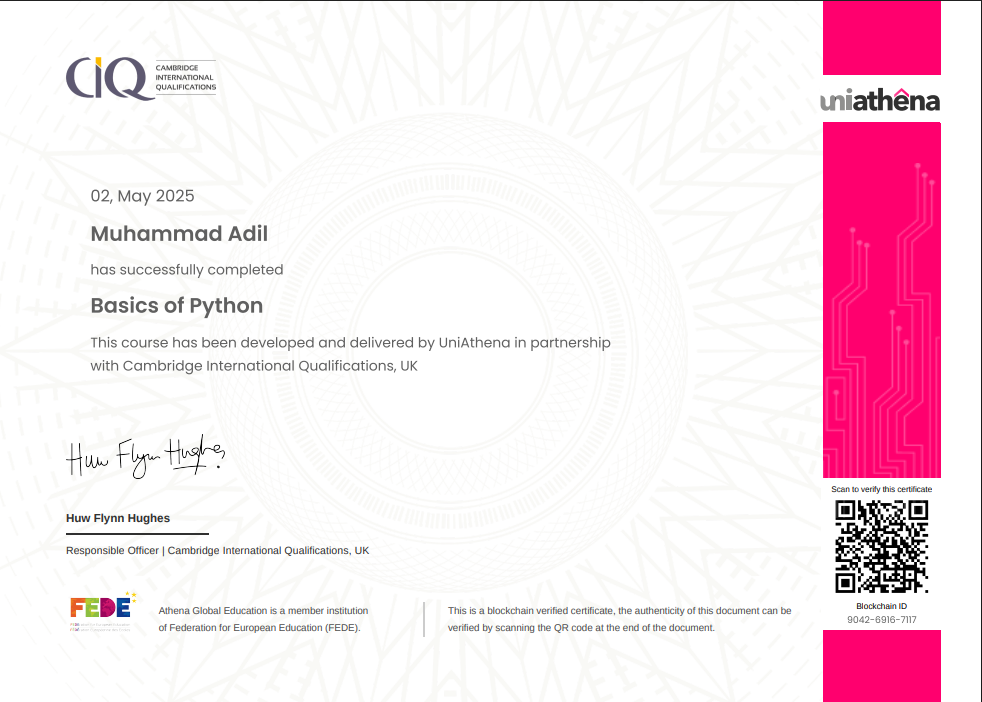
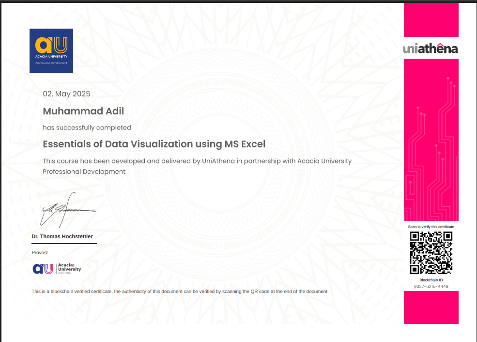
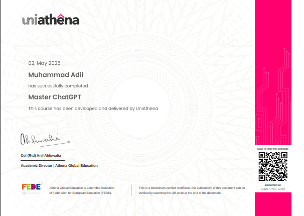

<!-- Muhammad Adil | Professional GitHub Profile -->

  

---

## Muhammad Adil
**Software Quality Assurance Engineer · Software Engineering Student**

I focus on product quality through structured testing, clear defect reporting, and practical problem-solving. I have hands-on experience testing web, mobile, and admin workflows, with an interest in API validation, databases, and test automation.

Alongside QA, I build and explore software projects using React, TypeScript, Python, and modern backend tools. I value reliable user experiences, maintainable solutions, and continuous learning.

## What I Work On

| Quality Assurance | Development & Tools |
|---|---|
| Functional, exploratory, UI testing | React, TypeScript, JavaScript |
| Smoke, sanity, regression, retesting | HTML, CSS, Tailwind CSS, Vite |
| Web, mobile, and admin workflows | Python, FastAPI |
| Test scenarios and test cases | PostgreSQL, MySQL, Supabase |
| API testing with Postman | Git, GitHub, Vercel |
| Role permissions, forms, documents, data flows | Playwright with Python — learning |
| Bug reproduction and developer-facing reports | Browser DevTools, Network inspection |

## Technology

 

Playwright automation and other learning areas are identified as ongoing development, not claimed as advanced proficiency.

## Selected Projects

 

## Certificates

<table>
<tr>
<td align="center" width="33%">

<b>Design Prompts for Everyday Work Tasks</b> Google · Coursera · Nov 2025
</td>
<td align="center" width="33%">

<b>Active Learner</b> Eazisols
</td>
<td align="center" width="33%">

<b>Creativity & Problem Solving</b> UniAthena · May 2025
</td>
</tr>
<tr>
<td align="center">

<b>Basics of Python</b> UniAthena · May 2025
</td>
<td align="center">

<b>Machine Learning Algorithms</b> UniAthena · May 2025
</td>
<td align="center">

<b>Data Visualization with Excel</b> UniAthena · May 2025
</td>
</tr>
<tr>
<td align="center">

<b>Master ChatGPT</b> UniAthena · May 2025
</td>
<td colspan="2" align="center" valign="middle">
<b>7 certificates & learning recognitions</b> 
Open any certificate image to view the original file.
</td>
</tr>
</table>

## QA Approach

**Understand → Plan → Test → Report → Retest**

I start by understanding requirements and user journeys, prepare focused scenarios, test expected and edge-case behaviour, document reproducible defects, and verify fixes with appropriate regression checks.

## Current Learning Focus

- **Automation:** Playwright, Python, pytest, and maintainable test structure
- **API & data:** Postman assertions, SQL queries, and database validation
- **Performance:** JMeter fundamentals and response-time analysis
- **Engineering:** React, TypeScript, FastAPI, PostgreSQL, and CI/CD basics

## GitHub Activity

 

Activity cards are provided by external services and may occasionally be unavailable. They reflect public GitHub activity, not certifications or skill ratings.

## Let's Connect

<a href="https://m-adil-one.vercel.app/">Portfolio</a> &nbsp;·&nbsp;
<a href="https://www.linkedin.com/in/muhammad-adil110/">LinkedIn</a> &nbsp;·&nbsp;
<a href="https://github.com/adilmeertest-cmyk">GitHub</a>

  

<i>Quality in every detail. Progress in every build.</i>

