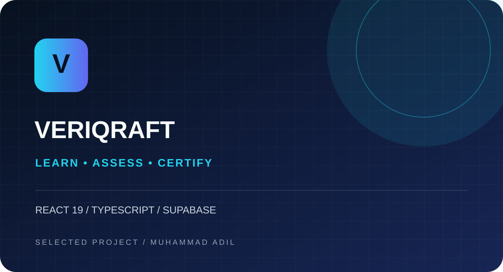
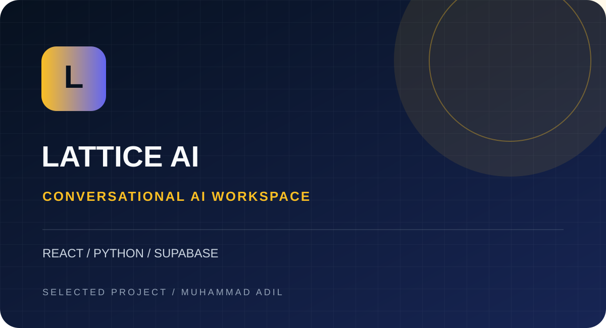
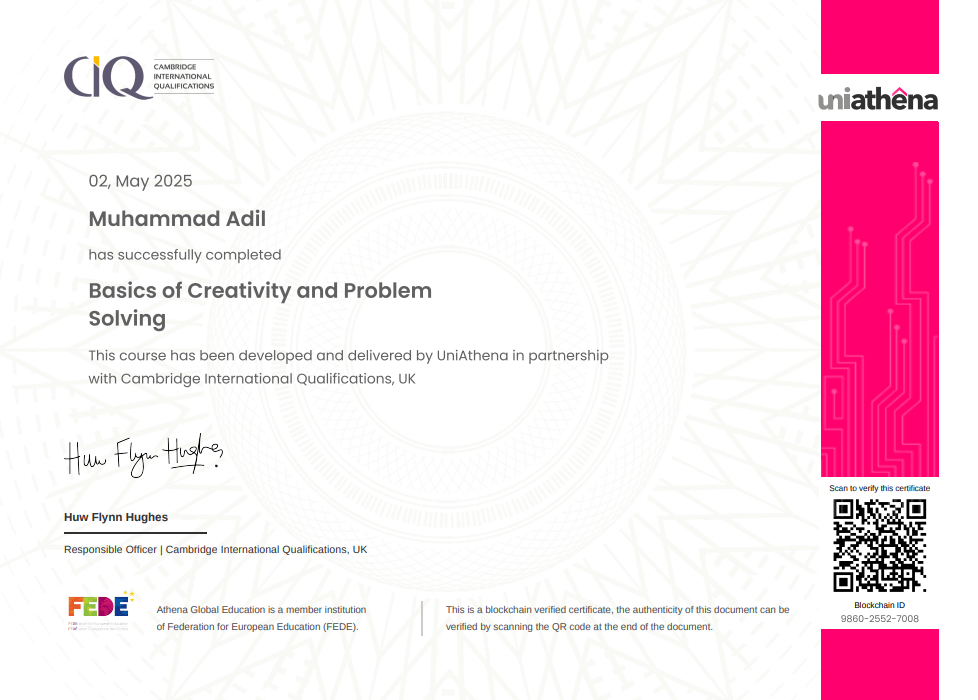
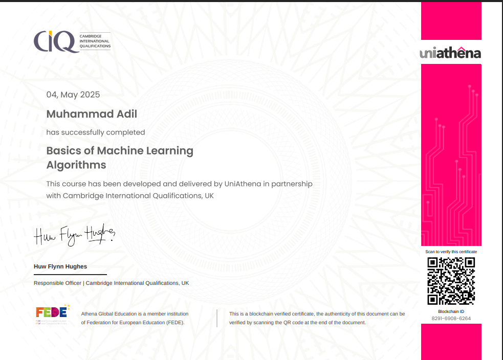

<!-- Muhammad Adil | Software QA Engineer & Developer -->

 

  

---

## QUALITY MINDED. BUILT WITH CURIOSITY.

**Test with purpose. Build with care. Improve continuously.**

SOFTWARE QUALITY ASSURANCE &nbsp;•&nbsp; WEB / MOBILE &nbsp;•&nbsp; API &nbsp;•&nbsp; DATABASES &nbsp;•&nbsp; SOFTWARE DEVELOPMENT

## About Me

I'm **Muhammad Adil**, a Software Quality Assurance Engineer and Software Engineering student with a growing focus on web and full-stack development. I enjoy understanding how products work, finding issues before users do, and building useful digital experiences.

My QA work includes functional, UI, exploratory, smoke, sanity, regression, and retesting activities across web, mobile, and admin workflows. I focus on requirement understanding, user journeys, role-based permissions, forms, document flows, data validation, reproducible bug reports, and clear communication with developers.

Alongside QA, I build and explore applications with React, TypeScript, Vite, Tailwind CSS, Python, FastAPI, PostgreSQL, and Supabase. I'm strengthening my API, database, automation, and software engineering skills through practical projects.

## Professional Snapshot

## Core Competencies

<table>
<tr>
<td width="50%" valign="top">

### Software Quality Assurance

- Manual software testing
- Functional and exploratory testing
- UI and usability checks
- Web and mobile application testing
- Smoke and sanity testing
- Regression and retesting
- Test scenarios and test case design
- Requirement analysis and user-flow validation
- Defect identification and reproducible bug reports
- Role-based access and permission checks
- Form, document, and workflow validation
- Cross-browser and responsive checks

</td>
<td width="50%" valign="top">

### Technical Testing & Engineering

- REST API testing with Postman
- HTTP methods and status-code validation
- JSON response inspection
- SQL / MySQL fundamentals
- PostgreSQL fundamentals
- Browser DevTools and Network inspection
- React and TypeScript development
- Responsive UI with Tailwind CSS
- Python and FastAPI project work
- Supabase Auth and database workflows
- Git and GitHub version control
- Vercel deployment workflows
- Playwright with Python — learning automation

</td>
</tr>
</table>

## Technology & Toolbelt

**Testing & Quality**

**Languages & Frontend**

**Backend, Database & Cloud**

**Developer Workflow**

Tool logos indicate technologies used in projects or currently being learned; they are not certification badges or proficiency ratings.

## Featured Projects

    

    

   

    

    

## Achievements & Milestones

- Hands-on QA across web, mobile, and admin workflows.
- End-to-end validation of user journeys, permissions, forms, documents, and data flows.
- Smoke, sanity, functional, exploratory, regression, and retesting practice.
- Reproducible bug reporting and developer-facing verification.
- API testing with Postman and SQL/database validation learning.
- Built and maintained full-stack, AI-focused, and portfolio projects.
- Continuous learning in Playwright automation, Python, SQL, performance testing, and CI/CD.
- Pursuing a BS in Software Engineering.

## Certificates & Recognition

<table>
<tr>
<td width="50%" align="center" valign="top">

**Design Prompts for Everyday Work Tasks**

Google · Coursera · 21 November 2025

</td>
<td width="50%" align="center" valign="top">

**Active Learner**

Eazisols · Date not shown

</td>
</tr>
</table>

<table>
<tr>
<td width="50%" align="center" valign="top">

**Basics of Creativity and Problem Solving**

UniAthena · Cambridge International Qualifications · 2 May 2025

</td>
<td width="50%" align="center" valign="top">

**Basics of Python**

UniAthena · Cambridge International Qualifications · 2 May 2025

</td>
</tr>
</table>

<table>
<tr>
<td width="50%" align="center" valign="top">

**Basics of Machine Learning Algorithms**

UniAthena · Cambridge International Qualifications · 4 May 2025

</td>
<td width="50%" align="center" valign="top">

**Essentials of Data Visualization using MS Excel**

UniAthena · Acacia University · 2 May 2025

</td>
</tr>
</table>

<table>
<tr>
<td width="50%" align="center" valign="top">

**Master ChatGPT**

UniAthena · 2 May 2025

</td>
<td width="50%"></td>
</tr>
</table>

Original certificate files are stored in this public profile repository, so image rendering does not depend on the portfolio repository's visibility.

## Professional QA Lifecycle

| Phase | Focus |
|:---:|---|
| **01 · DISCOVER** | Understand requirements, acceptance criteria, and user journeys |
| **02 · DESIGN** | Prepare test scenarios, test cases, and test data |
| **03 · EXECUTE** | Run functional, UI, exploratory, smoke, and regression checks |
| **04 · REPORT** | Document reproducible defects with clear steps and evidence |
| **05 · VERIFY** | Retest fixes and perform impact-based regression |
| **06 · IMPROVE** | Share findings and strengthen product quality continuously |

## Learning & Growth Roadmap

| Area | Next learning focus |
|---|---|
| Automation | Playwright, Python, pytest, maintainable test structure |
| API Quality | Advanced Postman assertions, collections, environments |
| Database Testing | SQL joins, constraints, data integrity, test validation |
| Performance | JMeter basics, load concepts, response-time analysis |
| Delivery | GitHub workflows and CI/CD fundamentals |
| Engineering | React, TypeScript, FastAPI, PostgreSQL architecture |

## GitHub Achievements & Activity

  

  

  

  

GitHub stats, contribution streaks, activity graphs, and trophy cards are generated by external services and may occasionally be unavailable. They reflect GitHub activity, not professional certifications. Official GitHub Achievements are earned through GitHub's own qualifying activities; this README does not claim to grant them.

## Beyond the Code

- **Quality-first thinking:** I value reliability, clear requirements, reproducible testing, and user-focused outcomes.
- **Curiosity:** I enjoy exploring how frontend, APIs, databases, and backend services work together.
- **Continuous improvement:** I keep learning through hands-on projects, testing practice, and Software Engineering studies.
- **Collaboration:** I aim to communicate issues clearly and work constructively with developers and teams.

## Connect With Me

  

**Open to learning, collaboration, and opportunities in Software QA and development.**

 

<i>Test with purpose · Build with care · Keep improving</i>

  

Designed in Markdown + SVG · Built with care by Muhammad Adil

